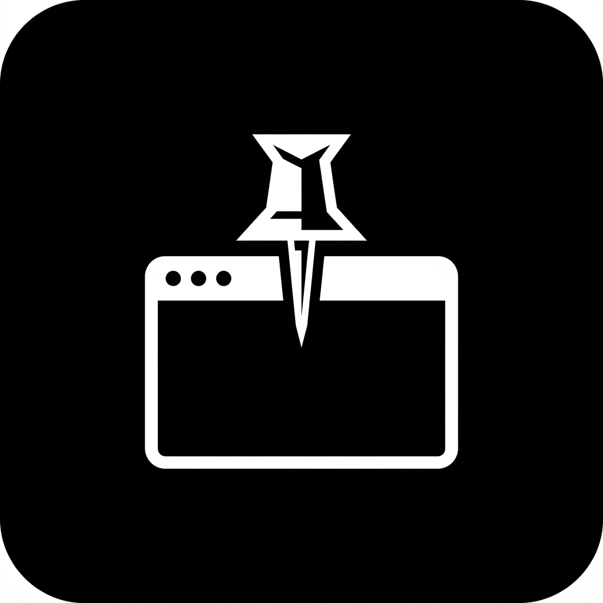
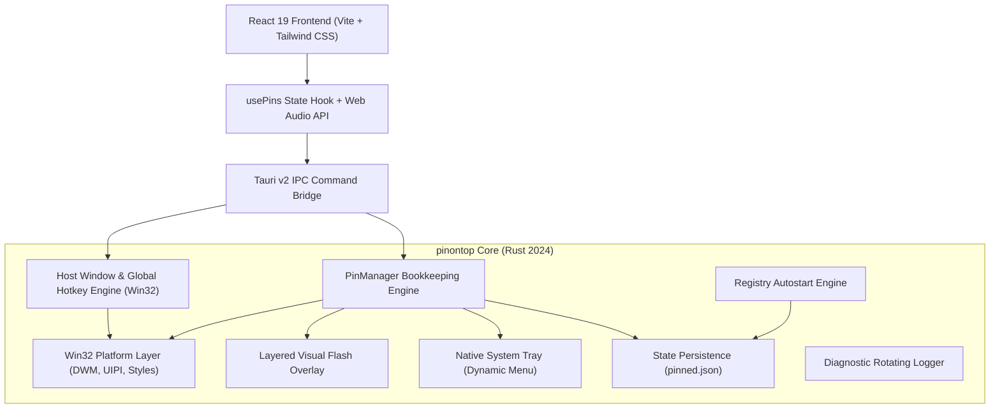

<div align="center">



# pinontop

**Keep any window always on top in Windows 10 & 11.**  
*A lightweight, ultra-responsive system utility engineered in Rust & Tauri v2.*

[](#)
[](#)
[](#)
[](#)
[](#)
[](LICENSE)

</div>

---

## 💡 About pinontop

Working on modern multi-display or high-resolution workspaces frequently requires juggling reference material alongside active work:
- Comparing code diffs or watching a technical talk while typing in an editor
- Keeping an LLM conversation or AI assistant pinned above your IDE
- Monitoring terminal logs, build pipelines, or system performance metrics
- Tracing or drawing over UI mockups, spreadsheets, or engineering diagrams
- Glancing at notes, cheat sheets, or chat windows during full-screen tasks

Most Windows applications do not provide native "Always on Top" functionality, and third-party tools are often bloated, unstable across reboots, or leak system resources.

**pinontop** is built from the ground up to solve this with surgical precision. Written with a high-performance **Rust** native platform engine and a sleek **React 19** frontend, pinontop consumes virtually **0% CPU** at idle, starts in milliseconds, survives system restarts, and operates completely offline with zero telemetry.

---

## ⚡ Core Features

### 📌 Instant Global Pinning
Pin or unpin any active window instantly using the global hotkey (`Win + Ctrl + T`) or select directly from the searchable **Window Picker**.

### 👁️ Per-Window Opacity Control
Adjust the transparency of pinned windows from **20% to 100%** on the fly using keyboard shortcuts (`Win + Ctrl + =` / `Win + Ctrl + -`) or a precise slider in the dashboard. Perfect for keeping reference material visible without obscuring your primary workspace.

### 🖱️ Transparent Click-Through Mode
Transform any pinned window into a non-intrusive interactive overlay. When **Click-Through** is enabled (`WS_EX_TRANSPARENT`), mouse clicks and scroll events pass directly through to whatever window is behind it—ideal for tracing diagrams or viewing reference videos while clicking in an IDE.

### ✨ Visual Flash Overlay
Whenever a window is pinned, unpinned, or hovered in the dashboard, **pinontop** projects a borderless, hardware-accelerated outline around the exact frame of the target window (calculated with `DwmGetWindowAttribute(DWMWA_EXTENDED_FRAME_BOUNDS)` to avoid drop-shadow misalignments).
- Smooth 300ms hold with a 250ms quadratic ease-out fade.
- Respects Windows accessibility settings (`SPI_GETCLIENTAREAANIMATION`).

### 🔄 Reboot Survival & Process Auto-Reattach
- **Session Awareness**: Windows shutdown and restarts (`WM_QUERYENDSESSION`/`WM_ENDSESSION`) save active pins to disk (`pinned.json`) so your layout is automatically restored when you log back in.
- **Process Watcher**: If an application closes or hasn't started yet, pinontop maintains it as a *Pending Pin* and automatically re-attaches top-most status as soon as that process opens.
- **Clean Exit**: Manual user quit clears session pins so you always start fresh when intended.

### 🛡️ Win32 Hardening & Stability
- **Topmost Re-enforcement Loop**: Background interval (1.5s) re-asserts `HWND_TOPMOST` if greedy game clients or full-screen applications attempt to displace pinned windows.
- **Shell Protection**: Strict class blacklist prevents accidental pinning of the Windows Taskbar (`Shell_TrayWnd`), Desktop (`Progman`), Start Menu, or Worker windows.
- **UIPI (User Interface Privilege Isolation)**: Gracefully detects elevation mismatches (e.g. attempting to pin an Administrator window from standard user mode) and displays actionable notifications rather than crashing.

### 📥 System Tray & Window Lifecycle
- Minimizes directly to the Windows system notification area (tray).
- Dynamic tray context menu listing all active pins with one-click unpin toggles.
- Quick access to Window Picker, Settings, and Quit.
- Automatic recovery if Windows Explorer restarts (`TaskbarCreated`).

### 🎨 Solid Monochrome Engineering Design
- High-contrast, typography-driven UI built with Plus Jakarta Sans, Geist, and Geist Mono.
- Full Light and Dark mode support with automatic Windows theme synchronization (`WM_SETTINGCHANGE`).
- Synthesized mechanical micro-haptic click audio feedback via Web Audio API.

---

## ⌨️ Default Keyboard Shortcuts

| Shortcut | Action | Description |
|---|---|---|
| <kbd>Win</kbd> + <kbd>Ctrl</kbd> + <kbd>T</kbd> | **Pin / Unpin Window** | Toggles always-on-top on the currently focused foreign window |
| <kbd>Win</kbd> + <kbd>Ctrl</kbd> + <kbd>=</kbd> | **Increase Opacity** | Increases target window opacity by 5% (up to 100%) |
| <kbd>Win</kbd> + <kbd>Ctrl</kbd> + <kbd>-</kbd> | **Decrease Opacity** | Decreases target window opacity by 5% (down to 20%) |
| <kbd>Win</kbd> + <kbd>Ctrl</kbd> + <kbd>P</kbd> | **Toggle pinontop** | Shows or hides the pinontop dashboard window |

> [!TIP]
> All shortcuts are fully rebindable in the **Edit Shortcuts** settings sheet. pinontop enforces safety rules ensuring shortcuts include at least one modifier key (`Win`, `Ctrl`, `Alt`, or `Shift`) to prevent accidental interception of normal typing.

---

## 🏗️ Architecture & Technology Stack



- **Frontend**: React 19, TypeScript 6, Vite 8, Tailwind CSS.
- **Backend**: Rust 2024 edition, Tauri v2.
- **Win32 Platform Integration**: `windows` crate (`v0.62.2`) with direct Win32 API calls for DWM frame attributes, layered window attributes, hotkey registration, and registry persistence.
- **IPC Linkage**: Delay-loaded Common Controls v6 (`comctl32.dll`) linkage ensuring maximum runtime stability and native Windows 10/11 visual styling.

---

## 📦 Installation & Releases

Download the latest production release from the [Releases](https://github.com/yeasin2002/pinontop/releases) page:

| Package | Format | Target | Description |
|---|---|---|---|
| **Standalone Executable** | `.exe` | Windows 10 / 11 (x64) | Single self-contained binary (< 5 MB), no install needed |
| **Setup Installer** | `pinontop_0.1.0_x64-setup.exe` | Windows 10 / 11 (x64) | Fast NSIS installer with desktop and start menu shortcuts |
| **MSI Installer** | `pinontop_0.1.0_x64_en-US.msi` | Windows 10 / 11 (x64) | Windows Installer package suitable for enterprise deployment |

---

## 🛠️ Building from Source

### Prerequisites
1. **Rust**: 1.85+ with MSVC toolchain (`rustup default stable-x86_64-pc-windows-msvc`).
2. **Node.js**: Node 18+ and `pnpm` package manager.
3. **C++ Build Tools**: Visual Studio Build Tools with the C++ workload installed.

### Clone & Install
```bash
git clone https://github.com/yeasin2002/pinontop.git
cd pinontop
pnpm install
```

### Run in Development Mode
```bash
# Runs Vite dev server and Tauri host window simultaneously
pnpm tauri dev
```

### Run Test Suite
```bash
# Runs all 22 Rust Win32 backend unit tests
cargo test --manifest-path src-tauri/Cargo.toml

# Frontend TypeScript verification & build
pnpm build
```

### Production Build
```bash
# Compiles optimized binary and creates MSI + NSIS distribution bundles
pnpm tauri build
```
The resulting executable will be in `src-tauri/target/release/pinontop.exe` (size ~4.7 MB).

---

## 📁 Storage & Configuration

| File / Registry Path | Purpose |
|---|---|
| `%APPDATA%\pinontop\pinned.json` | Pinned windows layout, process bindings, opacity, and user settings |
| `%APPDATA%\pinontop\pinontop.log` | Rotating diagnostic log file (capped at 512KB, keeps 1 backup) |
| `HKCU\Software\Microsoft\Windows\CurrentVersion\Run` | Autostart registry key (`PinIt` / `PinIt-dev`) with automatic self-repair |

---

## 🔒 Privacy & Security Guarantee

- **Strict Privacy Rule**: pinontop **never** inspects, reads, or transmits the contents of foreign windows. Window titles are only stored locally on disk for matching processes and are strictly excluded from all diagnostic logs.
- **Zero Telemetry**: No analytics, telemetry pings, or internet requests. All operations execute strictly on your local machine.
- **UIPI Isolation**: Runs safely under standard user privileges without demanding administrative elevation.

---

## 📄 License

This project is licensed under the **MIT License**. See the [LICENSE](LICENSE) file for details.
